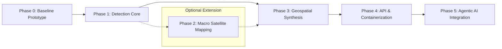

# Development Roadmap: SawitVision

This roadmap details the engineering phases for SawitVision, covering computer vision detection, counting metrics, geospatial vector integration, asynchronous services, and production AI capabilities.

---

## Operating Principles

1. **Open and Reproducible Data:** Exclusively utilize open academic datasets, verified public imagery, or self-collected aerial captures. Maintain transparent provenance and licensing records.
2. **Empirical Verification:** Every reported metric, throughput benchmark, and accuracy statistic is grounded in reproducible evaluations against held-out test splits.
3. **Independent Project Scope:** Developed as an open-source technical exploration of aerial computer vision and geospatial analytics for plantation monitoring.
4. **Clean Decoupling:** Modular separation between core computer vision inference, spatial geometry engines, and downstream service interfaces.

---

## Phase Breakdown

| Phase | Milestone Deliverables | Engineering Competencies Demonstrated |
|---|---|---|
| **Phase 0: Prototype Baseline** | Working standalone detection scripts, deterministic crown numbering (1..N), visual preview rendering, and crop-and-classify attribute extraction | Rapid prototyping, core image processing, visual verification |
| **Phase 1: Precision Detection Core** | Deep learning crown detector, windowed sliding inference (tiling), cross-tile deduplication, location-separated evaluation, count error metrics (MAE, MAPE, bias) | Production computer vision, metric alignment, rigorous spatial cross-validation |
| **Phase 2: Macro Field Segmentation** | Multi-spectral plantation boundary delineation from satellite imagery (Sentinel-2) using semantic segmentation architectures (U-Net / SegFormer) | Remote sensing, multispectral imagery processing, semantic segmentation |
| **Phase 3: Geospatial Synthesis** | Vectorization of detections into GeoJSON/Shapefile, management block spatial joins, stand density heatmaps (trees/ha), and interactive map visualization | Geospatial data engineering, GIS standards, coordinate reference systems |
| **Phase 4: Service & Deployment** | Asynchronous FastAPI service (`/v1/jobs`), worker queues, containerized Docker environment, ONNX CPU optimization, and CI automated testing | Backend engineering, distributed task execution, containerization, edge inference |
| **Phase 5: Agentic AI Integration** | Natural language agricultural assistant with tool-calling capabilities, structured JSON output validation, agronomic document retrieval (RAG), and evaluation suites | Production AI platform capabilities, function calling, agentic workflows, LLM evaluation |
| **Phase 6: Technical Documentation** | Interactive demo artifacts, model card documentation, failure mode gallery, and technical write-up | Technical communication, architecture documentation |

---

## Phase Details

### Phase 0: Baseline Prototype (Current Focus)
- End-to-end script ingesting high-resolution drone photos.
- Crown detection returning total tree inventory.
- Deterministic spatial sorting (top-to-bottom, left-to-right) assigning sequential IDs $1 \dots N$.
- Export of annotated high-resolution audit preview with labeled bounding boxes.
- Crop-and-classify module extracting individual crown chips and calculating canopy attributes (e.g. greenness, HSV profile).

### Phase 1: Precision Detection Core
- Tiled window inference with configurable spatial overlap (20%).
- Non-maximum suppression and duplicate elimination across tile seams.
- Rigorous location-separated evaluation suite comparing:
  - Detection metrics: Precision, Recall, F1, mAP@0.5.
  - Count metrics: MAE, MAPE, systematic bias, $R^2$.
- Failure mode logging covering deep shadows, high-density crown interlocking, and non-palm vegetation distractors.

### Phase 5: Production AI & Agentic Integration
Demonstrates practical production LLM engineering:
- **Tool-Calling Agent:** Natural language agent that translates user inquiries (e.g., *"Summarize stand count and vacancies in Block 4"*) into parameterized API tool invocations.
- **Structured Schema Validation:** Enforcement of typed JSON output schemas with automatic validation and recovery routines.
- **Domain Knowledge Retrieval (RAG):** Contextual retrieval over open agronomic and plantation management reference literature.
- **Evaluation Benchmark:** Automated test harness assessing tool invocation precision and answer fidelity.

---

## Milestone Execution Guide

